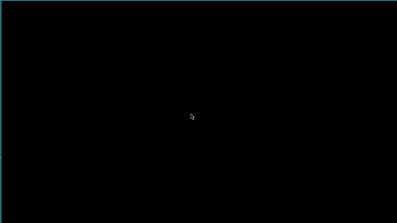

# 🔺 GEOMETRY SURVIVOR

A top-down geometrical survival game. Move with the mouse, fire your spells, survive wave after wave of geometric enemies and upgrade your arsenal between rounds.



> **Status:** completed (v1.0). The project is finished and no longer actively maintained.

## 🎮 How to play

Enemies spawn in waves, from simple triangles up to heptagons, and the further you get, the bigger and more numerous they become. Survive as long as you can: when you die, the game prints the wave you reached and your score.

Every so often the **Magic Shop** opens. There you pick either a new spell (or an upgrade for one you already own) or a stat boost, and then the fight continues with your new build.

### Controls

| Key | Action |
| --- | --- |
| **Mouse** | Move (the player follows the cursor) |
| **Z / X** | Cast the *aimed* spells (they shoot towards the mouse) |
| **C / V** | Cast the *area* spells (they trigger around you) |
| **Left Ctrl** | Call the next wave early |

**In the shop:**

| Key | Action |
| --- | --- |
| **Z / X / C / V** | Equip the offered spell in that slot (and level it up) |
| **B** | Upgrade the offered stat instead |

> The menu and the shop are printed in the **terminal**, so launch the game from one. The key presses go to the game window.

### Spell slots

Each slot has a fixed type, and the shop offers spells that match it:

| Slot | Key | Type |
| --- | --- | --- |
| Primary | Z | Aimed |
| Secondary | X | Aimed |
| Special | C | Area |
| Special 2 | V | Area |

Choosing a spell in the shop **replaces** whatever was in that slot, but its level is remembered: if it shows up again later, it comes back with the upgrades you gave it. Spell upgrades improve damage and reduce cooldown.

### Spells

| Type | Spell | Effect |
| --- | --- | --- |
| Aimed | Basic bullet | A single bullet towards the cursor |
| Aimed | Dash | A quick burst of movement |
| Aimed | Piercing bullet | Goes through enemies, hitting several times |
| Aimed | Spread shot | A cluster of bullets in a random-ish spread |
| Aimed | Triple shot | Three bullets in a cone |
| Area | Blast | A damaging burst around you |
| Area | Ice aura | **Freezes** enemies |
| Area | Fire aura | **Burns** enemies |
| Area | Thunder aura | **Stuns** enemies |

## 🏗️ Architecture

The game uses an **EC (Entity-Component)** architecture, where each entity contains all of its own information, handling its own updates, rendering, etc. While this approach is not as flexible or cache-friendly as a pure ECS (due to cache misses), it is a massive improvement over traditional OOP. Entities act like "Legos", easily built from various interchangeable components.

Components manage themselves, and all hold a reference to their parent entity to share information (e.g., the `SpriteComponent` needing the position from the `TransformComponent`). When a component needed specific variations but fulfilled the same purpose, I used the **CRTP (Curiously Recurring Template Pattern)** technique. This allows them to share the same internal ID as their base class, meaning the manager can call the same functionality without needing to know if the entity is an *AI Summoner* or an *AI Sniper*.

The game is divided into **States** (menu, playing, shop), and the core engine holds a pointer to the current state. To connect these states and share information between them, I implemented the **Blackboard pattern**, allowing all states to write down and update the data other states might need (spell levels, equipped spells, stat levels, current wave...).

## 🛠️ Media & Libraries

The game is built using **SDL2**. Instead of using raw C pointers, I created a custom RAII wrapper to modernize the library for C++, ensuring proper memory management with automatic destructors.

The code uses:

- **C++17**
- **SDL2** for rendering and window management.
- **CMake** as the build system.
- Smart pointers (`std::unique_ptr`, `std::shared_ptr`) for safe memory handling.
- `std::function` (lambdas) for callbacks.
- The Standard Template Library (STL) for data structures.

## 🚀 How to Build and Run

### Prebuilt binary (Linux x86_64)

Download the latest `.tar.gz` from the [Releases](../../releases) page, extract it and run `./GeometrySurvivorApp` from a terminal. SDL2 is linked statically, so there is nothing else to install.

It was built on Ubuntu 24.04 (x86_64), so older distributions may not be compatible. In that case, build it from source as described below.

### Building from source

**1. Install dependencies**

You need a C++17 compiler, **CMake 3.23 or newer** and the SDL2 development files. On Debian/Ubuntu-based systems (Ubuntu 24.04 or newer ships a recent enough CMake):

```bash
sudo apt update
sudo apt install build-essential cmake libsdl2-dev
```

**2. Clone and build**

```bash
git clone https://github.com/AutoPtrLab/GeometrySurvivor.git
cd GeometrySurvivor
cmake -DCMAKE_BUILD_TYPE=Release .
make -j
```

**3. Run**

The executable is generated in the project root, next to the `assets/` folder, so just run it from there:

```bash
./GeometrySurvivorApp
```

> Developed and tested on Linux. It should build on Windows and macOS with SDL2 and CMake available, but those platforms are untested.

## 📁 Project structure

```
GeometrySurvivor/
├── assets/          # fonts, sprites and other resources
├── include/         # headers
├── src/             # source code
└── CMakeLists.txt   # build configuration
```

## 🙏 Credits

- [SDL2](https://www.libsdl.org/), under the zlib license.

## 📄 License

Distributed under the MIT License. See [`LICENSE`](LICENSE) for details.
